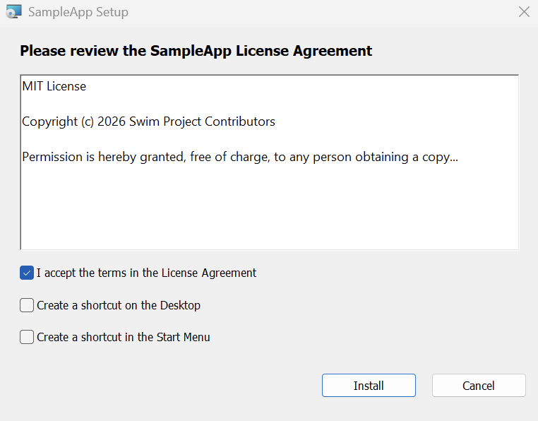

<!-- markdownlint-disable MD033 MD041 -->

<pre>
                   ⠀⠀⠀⠀⠀⠀⠀⠀⠀⠀⠀⠀⠀⠀⠀⠀⠀⣠⣴⣶⠾⠿⠿⠯⣷⣄⡀
                   ⠀⠀⠀⠀⠀⠀⠀⠀⠀⠀⠀⠀⠀⠀⢀⣼⣾⠛⠁⠀⠀⠀⠀⠀⠀⠈⢻⣦
                   ⠀⠀⠀⠀⠀⠀⠀⠀⠀⠀⠀⠀⣠⣾⠿⠁⠀⠀⠀⢀⣤⣾⣟⣛⣛⣶⣬⣿⣆
                   ⠀⠀⠀⠀⠀⠀⠀⠀⠀⠀⢀⣾⠟⠃⠀⠀⠀⠀⠀⣾⣿⠟⠉⠉⠉⠉⠛⠿⠟
                   ⠀⠀⠀⠀⠀⠀⠀⠀⢀⣴⡟⠋⠀⠀⠀⠀⠀⠀⠀⣿⡏⣤
                   ⠀⠀⠀⠀⠀⠀⠀⣠⡿⠛⠀⠀⠀⠀⠀⠀⠀⠀⠀⠙⣷⡍⠀⠀⠀⠀⠀⠀⠀⠀⠀⠀⢀⣀⣀⣤⣤⣤⣀
                   ⠀⠀⠀⠀⠀⣠⣼⡏⠀⠀⠀⠀⠀⠀⠀⠀⠀⠀⠀⠀⠈⠙⠷⣤⣤⣠⣤⣤⡤⡶⣶⢿⠟⠹⠿⠄⣿⣿⠏⠀⣀⣤⡦⠀⠀⠀⠀⣀⡄
                   ⢀⣄⣠⣶⣿⠏⠀⠀⠀⠀⠀⠀⠀⠀⠀⠀⠀⠀⠀⠀⠀⠀⠀⠀⠈⠉⠓⠚⠋⠉⠀⠀⠀⠀⠀⠀⠈⠛⡛⡻⠿⠿⠙⠓⢒⣺⡿⠋⠁
                   ⠉⠉⠉⠛⠁⠀⠀⠀⠀⠀⠀⠀⠀⠀⠀⠀⠀⠀⠀⠀⠀⠀⠀⠀⠀⠀⠀⠀⠀⠀⠀⠀⠀⠀⠀⠀⠀⠀⠀⠀⠀⠀⠀⠀⠀⠉⠉⠁
</pre>

<h1 align="center">swim</h1>

<p align="center">
  A simple, no-nonsense, Windows Installer (`.msi`) creation tool written in <strong>Zig</strong>.
</p>

<p align="center">
  <a href="https://mit-license.org">
    
  </a>
  <a href="https://en.wikipedia.org/wiki/AI-assisted_software_development">
    
  </a>
  <a href="https://ziglang.org/documentation/0.17.0">
    
  </a>
</p>

<p align="center">
  <a href="./releases/latest"><strong>Download</strong></a> &bull;
  <a href="#examples">Examples</a> &bull;
  <a href="#build">Build from source</a>
</p>

<p align="center">
  
</p>

<!-- markdownlint-enable MD033 MD041 -->

## Features

- **Auto GUID:** Automatically generates product/upgrade code GUID based on program title,
  version, and publisher/manufacturer information.
- **Multi-Arch Target Support:** `x64` (AMD64), `arm64` (AArch64), `arm` (ARM 32-bit),
  and `x86` (Intel 32-bit)
- **Intelligent Installation Scope:**
  - **Auto (Default):** Automatically installs to `C:\Program Files\<AppName>` when launched with
    administrative rights, and falls back to `%LocalAppData%\<AppName>` when launched by standard
    unprivileged users without triggering UAC elevation prompts.
  - **Per-Machine:** Forces installation to `C:\Program Files\<AppName>`.
  - **Per-User:** Forces installation to `%LocalAppData%\<AppName>`.
- **Native Uninstall/Repair Support:** Integrate natively with Windows `Add/Remove Programs`.
  The installer detects when the current program version is already installed and shows a custom
  `Uninstall/Repair` screen.
- **Windows Authenticode Code Signing:**
  - Native dual-scope signing: signs both the outer `.msi` installer package and individual
    PE binaries (`.exe` / `.dll`) in memory.
  - Supports ECDSA (P-384, P-256) and RSA PKCS#1 v1.5 with SHA-256 / SHA-384.
  - RFC 3161 compliant HTTP timestamping (`--timestamp-url`).
- **Custom File Placement:** Allows custom file placement relative to the install directory
  through `<source>:<destination>`.
- **Main Exe Shortcut Creation:** Detects the main exe, first passed as `<file>`, or assigned manually
  with `--main <path>`, and creates Desktop/Start Menu shortcuts during installation.
- **Desktop/Start Menu Shortcuts Control:** Allow users to opt out of creating Desktop and
  Start Menu shortcuts during installation.
- **Lightweight UI Customization:**
  - **License Agreement:** Pass `-l / --license <file>` (`.rtf` or plain text). Plain text is
    automatically converted to Rich Text Format (UTF-8 supported). Shows a screen requiring the
    user to agree with the license before proceeding with the installation.
  - **Application Icon:** Pass `-i / --icon <app.ico>`. Embeds the icon for `Add/Remove Programs`
    and the Desktop/Start Menu shortcuts.
  - **Application Metadata:** Configure program title, version, publisher/manufacturer, target
    architecture, and package timestamp.

## Usage

```text
swim - Simple Windows Installer (.msi) Creator

Usage:
  swim [-h] [-n <name>] [-o <file.msi>] [-v <x.x.x.x>] [-m <name>] [-a <arch>]
       [-s <scope>] [-l <file>] [-i <file.ico>] [-t <seconds>] [--main <path>]
       [--sign-cert <file>] [--sign-key <file>] [--sign-chain <file>...]
       [--sign-desc <desc>] [--timestamp-url <url>] <file>...

Options:
  -n, --name <name>               Application name (required)
  -o, --output <file.msi>         Output MSI file (default: <name>.msi)
  -v, --version <x.x.x.x>         Application version, 1-4 numbers (default: 1.0.0.0)
  -m, --manufacturer <name>       Publisher / Manufacturer (default: <name>)
  -a, --arch <arch>               Target architecture: x64, arm64, arm, x86 (default: x64)
  -s, --scope <scope>             Installation scope: auto, machine, user (default: auto)
  -l, --license <file>            License agreement file (.rtf or text)
  -i, --icon <file.ico>           Application icon (installer, shortcuts, Add/Remove Programs)
  -t, --timestamp <seconds>       Package timestamp in Unix seconds (default: current time)
      --main <path>               File that gets the shortcuts (default: first .exe)
      --sign-cert <file>          Certificate file for Authenticode signing (PEM or DER)
      --sign-key <file>           Private key file for Authenticode signing (PEM or DER)
      --sign-chain <file>...      Intermediate CA certificate chain (PEM or DER)
      --sign-desc <desc>          Description for Authenticode signature (default: <name>)
      --timestamp-url <url>       RFC 3161 timestamp server URL (e.g. DigiCert)
  -h, --help                      Show this help message
  <file>...                       Files to package (<path> or <source>:<destination>)
```

## Examples

### 1. Zero-Config Dual-Scope Installer (Default: Auto)

Package an executable, dynamic library, and configuration file. The resulting installer
automatically detects privileges at runtime, installing to `Program Files` for administrators and
`%LocalAppData%` for standard users:

```bash
swim -n "MyCoolApp" \
      -v "1.0.0" \
      -m "Acme Corp" \
      -o MyCoolApp-1.0.0.msi \
      bin/mycoolapp.exe \
      lib/core.dll \
      assets/config.json
```

### 2. Per-User Installer with License Agreement, Icon, and Custom Placement

Install directly to `%LocalAppData%\ToolApp` for non-admin users with an interactive license
agreement dialog, icon and custom asset placement:

```bash
swim -n "ToolApp" \
      -v "2.4.0" \
      -m "Tool Makers" \
      -s user \
      -l LICENSE.txt \
      -i icons/app.ico \
      -o ToolApp-Setup.msi \
      bin/tool.exe \
      assets/data.bin:resources/data.bin
```

### 3. Authenticode Code Signing with RFC 3161 Timestamping

Sign the `.msi` package and automatically sign all contained `.exe` and `.dll` binaries:

```bash
swim -n "SecureApp" \
      -v "1.0.0" \
      -m "Acme Corp" \
      --sign-cert certs/leaf.pem \
      --sign-key certs/leaf.key \
      --sign-chain certs/intermediate.pem \
      --sign-desc "Acme Secure Application" \
      --timestamp-url http://timestamp.digicert.com \
      -o SecureApp-Setup.msi \
      bin/app.exe \
      lib/plugin.dll
```

## Code Signing & Keystore Handling

`swim` accepts standard PEM (`.pem`, `.crt`, `.key`) and DER (`.der`, `.cer`) files directly.

### Converting `.pfx` / `.p12` Keystores

If your certificate is stored in a `.pfx` or `.p12` archive, extract the certificate and private
key using `openssl`:

```bash
# Extract leaf certificate and CA chain (PEM)
openssl pkcs12 -in certificate.pfx -nokeys -out cert.pem

# Extract unencrypted private key (PEM)
openssl pkcs12 -in certificate.pfx -nocerts -nodes -out key.pem
```

### Payload Validation Rules

When building installers, `swim` enforces these strict rules:

1. **Unsigned Installer Integrity:** An unsigned installer cannot embed signed executables or DLLs.
2. **Certificate Mismatch Protection:** A signed installer cannot embed binaries signed with a
   different certificate.
3. **Payload Auto-Signing:** Unsigned PE payloads (`.exe`, `.dll`) are automatically signed
   in-memory using the provided signing credentials.
4. **Pre-Signed PE Validation:** Pre-signed PE binaries matching the installer certificate are
   validated and preserved as-is.
5. **Non-PE Pass-Through:** Non-PE data files (configuration, licenses, assets) pass through
   directly into the cabinet, protected by the outer MSI signature.

## Build

Requires [**Zig 0.17.0**][zig-download].

```bash
# Build the swim binary for host
zig build -Doptimize=ReleaseFast

# The executable will be at:
./zig-out/bin/swim
```

### Cross-Compilation

`swim` cross-compiles and is tested on the following platforms:

```bash
# Linux
zig build -Dtarget=x86_64-linux
zig build -Dtarget=aarch64-linux

# Windows
zig build -Dtarget=x86_64-windows
zig build -Dtarget=aarch64-windows

# macOS
zig build -Dtarget=x86_64-macos
zig build -Dtarget=aarch64-macos
```

## Development

```bash
zig build test --summary all       # unit tests + formatting check
zig build test -Dtest-filter=cab   # run matching tests only
zig build lint                     # formatting check + compile check
zig build check                    # fast compile check (-fno-emit-bin)
zig build fmt                      # reformat sources in-place
```

`test_fixtures/` holds a tiny executable, DLL, icon and text files for trying the tool by hand.

### Verify on Windows

```cmd
msiexec.exe /i package.msi /qn /l*v install.log
msiexec.exe /x package.msi /qn
```

## License

MIT license.

[zig-download]: https://ziglang.org/download/
